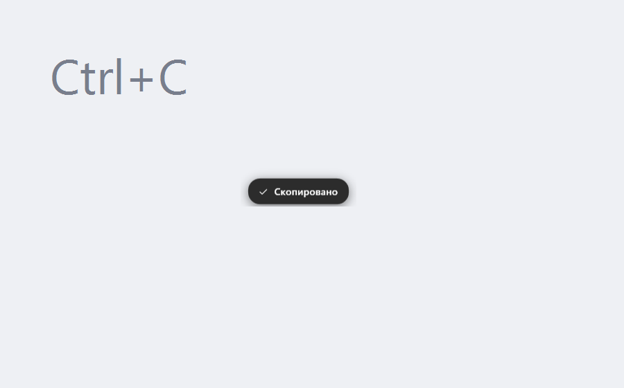

<div align="center">


# CopyPush

**A tiny Windows utility: whenever you copy with `Ctrl+C`, a neat «Copied» toast
pops up right at your mouse cursor.**

[](https://github.com/UniqueGanich/CopyPush/releases)
[](LICENSE)
[](https://microsoft.com/windows)

[Русский](README.md)

</div>

---



## Why

Pressing `Ctrl+C` and **not knowing whether it worked** is a small but constant
annoyance — you have to paste somewhere just to check. CopyPush removes the question
with a single toast right at your cursor.

## Features

- **Global `Ctrl+C` binding** — works in every application, not just one.
- **Breaks nothing.** `Ctrl+C` is never swallowed: a *read-only* hook is used, so it
  still interrupts a process in the terminal and still acts as a game key.
- **No false positives.** The toast appears only if the clipboard actually changed
  after the keypress.
- **Follows the system theme.** The surface matches system windows, the text is
  contrasting. The accent colour is read from the Windows theme and picked up live.
- **Stays out of the way.** The window does not steal clicks, does not activate,
  and never shows up in `Alt+Tab`.
- **Keeps a log** at `%LOCALAPPDATA%\CopyPush\CopyPush.log` in case something
  misbehaves.

## Installation

1. Download an archive from the [Releases](https://github.com/UniqueGanich/CopyPush/releases) page.
2. Unpack it anywhere (e.g. `C:\Tools\CopyPush`).
3. Run `CopyPush.exe` — an icon appears in the tray.

Done. `Ctrl+C` in any app now shows the «Copied» toast.

| Archive | Size | Requires |
|---|---|---|
| `CopyPush-x.y.z-win-x64.zip` | ~35 MB | nothing, works out of the box |
| `CopyPush-x.y.z-win-x64-small.zip` | ~10 MB | [.NET 8 Desktop Runtime](https://dotnet.microsoft.com/download/dotnet/8.0) |

Autostart is **off** by default — enable it from the tray menu
(“Run at startup”).

### Uninstall

Run `Uninstall.cmd` from the program folder. It removes autostart, settings and
the program itself. You can also uninstall it from Windows Settings → Apps.

## Settings

Everything lives in the tray icon menu:

| Item | Options |
|---|---|
| Show notification | on / off |
| Show on any clipboard change | on / off (also react to right-click → Copy) |
| Position | at cursor / screen center / bottom right |
| Style | system / accent / contrast |
| Duration | fast / normal / slow |
| Run at startup | on / off |

## How it works

```
Ctrl+C  ──►  WH_KEYBOARD_LL (observation only, never swallows the key)
                    │
                    ├──►  "copy requested" flag (1.5 s window)
                    │
 WM_CLIPBOARDUPDATE ─┘
        did the clipboard change?
             │ yes                   │ no
             ▼                       ▼
        show the toast          do nothing
```

Because the app verifies that the clipboard actually changed, `Ctrl+C` in a
terminal (which interrupts the process) and in games never trigger a false
notification.

Technically:

- **Hook** — `SetWindowsHookEx(WH_KEYBOARD_LL)`. The callback always returns
  `CallNextHookEx`, so input reaches the app unchanged.
- **Confirmation** — `AddClipboardFormatListener` + `WM_CLIPBOARDUPDATE`,
  with `GetClipboardSequenceNumber` as a fallback.
- **Toast** — a WPF window with `AllowsTransparency` (layered window, per-pixel
  alpha) and `WS_EX_NOACTIVATE | WS_EX_TOOLWINDOW | WS_EX_TRANSPARENT`.
- **Animation** — a `Storyboard` over `RenderTransform` (48 px rise) and `Opacity`.
- **Theme** — `AppsUseLightTheme` plus the accent from `Explorer\Accent\AccentPalette`
  and WinRT `UISettings`; colours are re-read when the theme changes.

## Requirements

- Windows 10 build 19041 (20H1) or newer
- Windows 11 — fully supported, including live theme changes
- **No administrator rights required**

## Building from source

Requires the [.NET 8 SDK](https://dotnet.microsoft.com/download/dotnet/8.0).

```bash
git clone https://github.com/UniqueGanich/CopyPush.git
cd CopyPush

# single .exe with everything inside (no .NET needed on the target machine)
dotnet publish -c Release -r win-x64 --self-contained true \
  -p:PublishSingleFile=true -p:IncludeNativeLibrariesForSelfExtract=true \
  -p:EnableCompressionInSingleFile=true -o out
```

Full cycle (build + install + launch): `tools\deploy.ps1`.
The icon is generated by `tools\make-icon.ps1`, screenshots by `tools\make-screenshots.ps1`.

## Project layout

```
CopyPush/
├── Program.cs              entry point, wires everything together
├── Interop/                P/Invoke: hook, clipboard, window, cursor, DPI
├── Hooks/                  KeyboardHook (WH_KEYBOARD_LL), MessageWindow
├── Services/               CopyDetector, ThemeService, ToastService, SettingsService, TrayIcon
├── Views/ToastWindow.cs    the toast (UI built in code, no XAML)
├── Resources/              application icon
├── assets/                 screenshots and icons for the README
├── tools/                  deploy.ps1, make-icon.ps1, make-screenshots.ps1, Uninstall.cmd
└── .github/workflows/      CI (build) and Release (publish on tag)
```

## License

[MIT](LICENSE) © 2026 Ivan Zakharov
