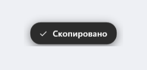

<div align="center">


# CopyPush

**Маленькая утилита для Windows: при копировании по `Ctrl+C` у курсора мыши
всплывает аккуратная плашка «Скопировано».**

[](https://github.com/UniqueGanich/CopyPush/releases)
[](LICENSE)
[](https://microsoft.com/windows)

[English](README.en.md)

</div>

---


## Зачем

Нажать `Ctrl+C` и **не знать, сработало ли копирование** — мелкое, но постоянное
раздражание: приходится вставлять в поле, чтобы проверить. CopyPush снимает вопрос
одной плашкой прямо у курсора.

## Что умеет

- **Глобальная привязка `Ctrl+C`** — работает в любом приложении, а не только в вашем.
- **Ничего не ломает.** `Ctrl+C` не перехватывается: используется хук *на чтение*,
  поэтому в консоли он по-прежнему прерывает процесс, а в играх работает как игровая клавиша.
- **Без ложных срабатываний.** Плашка появляется, только если содержимое буфера
  действительно изменилось после нажатия.
- **Цвет системной темы.** Фон — как у системных окон, текст контрастный.
  Акцентный цвет берётся из темы Windows и подхватывается на лету, без перезапуска.
- **Не мешает.** Окно не перехватывает клики, не активируется и не появляется в `Alt+Tab`.
- **Журнал** `%LOCALAPPDATA%\CopyPush\CopyPush.log` — если что-то пойдёт не так, видно почему.

## Установка

1. Скачайте архив со страницы [Releases](https://github.com/UniqueGanich/CopyPush/releases).
2. Распакуйте в любую папку (например `C:\Tools\CopyPush`).
3. Запустите `CopyPush.exe` — появится иконка в трее.

Готово. Теперь `Ctrl+C` в любом приложении покажет плашку «Скопировано».

| Архив | Размер | Требования |
|---|---|---|
| `CopyPush-x.y.z-win-x64.zip` | ~35 МБ | ничего, работает сразу |
| `CopyPush-x.y.z-win-x64-small.zip` | ~10 МБ | [.NET 8 Desktop Runtime](https://dotnet.microsoft.com/download/dotnet/8.0) |

Автозапуск по умолчанию **выключен** — включается в меню иконки в трее
(«Запускать вместе с Windows»).

### Удаление

Запустите `Uninstall.cmd` из папки программы — он уберёт автозапуск, настройки и саму программу.
Ещё можно удалить через «Параметры → Приложения».

## Настройки

Всё настраивается в меню иконки в трее:

| Пункт | Варианты |
|---|---|
| Показывать уведомление | вкл / выкл |
| Показывать при любом изменении буфера | вкл / выкл (реагировать на копирование правой кнопкой мыши) |
| Позиция | у курсора / по центру экрана / в правом нижнем углу |
| Оформление | системный / акцентный / контрастный |
| Длительность | быстро / обычно / медленно |
| Запускать вместе с Windows | вкл / выкл |

Три варианта оформления:

| Системный | Акцентный | Контрастный |
|---|---|---|
|  |  | |

## Как это работает

```
Ctrl+C  ──►  WH_KEYBOARD_LL (наблюдение, ничего не подавляет)
                    │
                    ├──►  флаг "копирование запрошено" (окно 1.5 с)
                    │
 WM_CLIPBOARDUPDATE ─┘
        буфер изменился?
             │ да                    │ нет
             ▼                       ▼
        показать плашку        ничего не делать
```

Благодаря проверке «буфер реально изменился» `Ctrl+C` в терминале (это прерывание
процесса) и в играх не вызывают ложных уведомлений.

Технически:

- **Хук** — `SetWindowsHookEx(WH_KEYBOARD_LL)`. Обработчик всегда возвращает
  `CallNextHookEx`, поэтому ввод уходит в приложение без изменений.
- **Подтверждение** — `AddClipboardFormatListener` + `WM_CLIPBOARDUPDATE`,
  плюс `GetClipboardSequenceNumber` как страховка.
- **Плашка** — WPF-окно с `AllowsTransparency` (layered window, попиксельная альфа),
  расширенные стили `WS_EX_NOACTIVATE | WS_EX_TOOLWINDOW | WS_EX_TRANSPARENT`.
- **Анимация** — `Storyboard` над `RenderTransform` (подъём на 48 px) и `Opacity`.
- **Тема** — `AppsUseLightTheme` + акцент из `Explorer\Accent\AccentPalette`
  и WinRT `UISettings`; цвета перечитываются при смене темы.

## Требования

- Windows 10 версии 19041 (20H1) или новее
- Windows 11 — полная поддержка, включая живую смену темы
- Права администратора **не нужны**

## Сборка из исходников

Нужен [.NET 8 SDK](https://dotnet.microsoft.com/download/dotnet/8.0).

```bash
git clone https://github.com/UniqueGanich/CopyPush.git
cd CopyPush

# один .exe со всем внутри (не требует .NET на компьютере)
dotnet publish -c Release -r win-x64 --self-contained true \
  -p:PublishSingleFile=true -p:IncludeNativeLibrariesForSelfExtract=true \
  -p:EnableCompressionInSingleFile=true -o out
```

Полный цикл (сборка + установка + запуск) — `tools\deploy.ps1`.
Иконка генерируется скриптом `tools\make-icon.ps1`, скриншоты — `tools\make-screenshots.ps1`.

## Структура проекта

```
CopyPush/
├── Program.cs              точка входа, сборка всех компонентов
├── Interop/                P/Invoke: хук, буфер, окно, курсор, DPI
├── Hooks/                  KeyboardHook (WH_KEYBOARD_LL), MessageWindow
├── Services/               CopyDetector, ThemeService, ToastService, SettingsService, TrayIcon
├── Views/ToastWindow.cs    плашка (интерфейс строится в коде, без XAML)
├── Resources/              иконка приложения
├── assets/                 скриншоты и иконки для README
├── tools/                  deploy.ps1, make-icon.ps1, make-screenshots.ps1, Uninstall.cmd
└── .github/workflows/      CI (сборка) и Release (публикация по тегу)
```

## Лицензия

[MIT](LICENSE) © 2026 Иван Захаров
