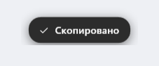
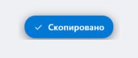
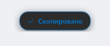

<div align="center">


# CopyPush

**Маленькая утилита для Windows: при копировании по `Ctrl+C` у курсора мыши
всплывает аккуратная плашка «Скопировано».**

[](https://github.com/UniqueGanich/CopyPush/releases)
[](LICENSE)
[](https://microsoft.com/windows)
[](src/CopyPush/Services/Localization.cs)

## **[English](README.md)**

</div>

---

> **⚠️ ПРЕДУПРЕЖДЕНИЕ:**
>
> Проект полностью создан ИИ агентом через OpenCode, потому что мне казалось довольно удобным
> иметь уведомление о копировании, я не обещаю 100% работоспособность или красивый код.
>
> Связаться со мной можно способами указанными в аккаунте.


# КАК НАСТРАИВАТЬ

Всё настраивается в меню иконки в трее:

| Пункт | Варианты |
|---|---|
| Показывать уведомление | вкл / выкл |
| Показывать при любом изменении буфера | вкл / выкл (реагировать на копирование правой кнопкой мыши) |
| Позиция | у курсора / по центру экрана / в правом нижнем углу |
| Оформление | системный / акцентный / контрастный |
| Длительность | быстро / обычно / медленно |
| **Language** | автоматически (системный) / Русский / English / Українська / Deutsch / Français / Español / 日本語 / 한국어 / 简体中文 / 繁體中文 |
| Запускать вместе с Windows | вкл / выкл |

## Три варианта оформления

| Системный | Акцентный | Контрастный |
|:---:|:---:|:---:|
|  |  |  |

## Установка

Готовые сборки лежат в [Releases](https://github.com/UniqueGanich/CopyPush/releases):

| Что скачать | Размер | Требования |
|---|---|---|
| [CopyPush-1.1.0.zip](https://github.com/UniqueGanich/CopyPush/releases/download/v1.1.0/CopyPush-1.1.0.zip) | 55.6 МБ | Windows 10/11, работает из коробки |
| [CopyPush-1.1.0-Without-NET.zip](https://github.com/UniqueGanich/CopyPush/releases/download/v1.1.0/CopyPush-1.1.0-Without-NET.zip) | 0.2 МБ | Windows 10/11, [.NET 8 Desktop Runtime](https://dotnet.microsoft.com/download/dotnet/8.0) |

1. Скачайте архив и распакуйте в любую папку (например `C:\CopyPush`).
2. Запустите `CopyPush.exe` - появится иконка в трее.
3. Готово: `Ctrl+C` в любом приложении покажет плашку «Скопировано».

Автозапуск по умолчанию **включён** - отключается в меню иконки в трее, при отключении автозапуска - программа пропадает из выбора в диспетчере задач, переключайте в трее.

## Удаление

Запустите `Uninstall.cmd` из папки программы - он уберёт автозапуск, настройки и саму программу.
Ещё можно удалить через «Параметры → Приложения».

## Требования

- Windows 10 версии 19041 (20H1) или новее
- Windows 11 - полная поддержка, включая живую смену темы

## Что умеет

- **Работает в любом приложении.**
- **Нет ложных срабатываний.** Плашка появляется, только если содержимое буфера
  действительно изменилось после нажатия.
- **Язык не помеха.** Интерфейс и надпись «Скопировано» могут отображаться на следующих языках:
  Русский, English, Українська, Deutsch, Français, Español, 日本語, 한국어, 简体中文, 繁體中文.
  Язык можно зафиксировать вручную: меню иконки в трее → **Language** (этот пункт всегда
  подписан по-английски, чтобы его можно было найти, даже если интерфейс оказался
  на незнакомом языке). По запросу я могу добавить новые языки
- **Цвет системной темы.** Фон - как у системных окон, текст контрастный.
  Акцентный цвет берётся из темы Windows и подхватывается на лету.
- **Не мешает.** Окно не перехватывает клики, не активируется и не появляется в `Alt+Tab`.
- **Не выскакивает поверх игр и видео.** Если активное окно занимает весь монитор,
  плашка не показывается.
- **Пишет в журнал всё, что происходит** - включая непойманные ошибки, - так что
  если что-то пойдёт не так, причина будет видна. Журнал: `%LOCALAPPDATA%\CopyPush\CopyPush.log`.

## Язык

По умолчанию язык берётся из системы: `Windows → Параметры → Время и язык → Язык и регион →
Предпочтительные языки`. Если там первым стоит русский - интерфейс и надпись будут русскими,
если английский - английскими. Любой из десяти поддерживаемых языков можно зафиксировать
вручную: меню иконки в трее → **Language**. После смены языка Windows достаточно перезапустить CopyPush.

# Техническая часть
## Как это работает

```
Ctrl+C  ──►  WH_KEYBOARD_LL (наблюдение, ничего не подавляет)
                    │
                    ├──►  флаг "копирование запрошено" (окно 1.5 с)
                    │
 WM_CLIPBOARDUPDATE ─┘
        буфер изменился?
             │ да                    │ нет
             ▼                       ▼
        показать плашку        ничего не делать
```

Благодаря проверке «буфер реально изменился» `Ctrl+C` в терминале (это прерывание
процесса) и в играх не вызывают ложных уведомлений.

Технически:

- **Хук** - `SetWindowsHookEx(WH_KEYBOARD_LL)`. Обработчик всегда возвращает
  `CallNextHookEx`, поэтому ввод уходит в приложение без изменений.
- **Подтверждение** - `AddClipboardFormatListener` + `WM_CLIPBOARDUPDATE`,
  плюс `GetClipboardSequenceNumber` как страховка.
- **Плашка** - WPF-окно с `AllowsTransparency` (layered window, попиксельная альфа),
  расширенные стили `WS_EX_NOACTIVATE | WS_EX_TOOLWINDOW | WS_EX_TRANSPARENT`.
- **Анимация** - `Storyboard` над `RenderTransform` (подъём на 48 px) и `Opacity`.
- **Тема** - `AppsUseLightTheme` + акцент из `Explorer\Accent\AccentPalette`
  и WinRT `UISettings`; цвета перечитываются при смене темы.
- **Язык** - `CultureInfo.CurrentUICulture` (язык системы) либо зафиксированный в настройках.

## Сборка из исходников

Нужен [.NET 8 SDK](https://dotnet.microsoft.com/download/dotnet/8.0).

```bash
git clone https://github.com/UniqueGanich/CopyPush.git
cd CopyPush

# один .exe со всем внутри (не требует .NET на компьютере)
dotnet publish src/CopyPush/CopyPush.csproj -c Release -r win-x64 --self-contained true \
  -p:PublishSingleFile=true -p:IncludeNativeLibrariesForSelfExtract=true \
  -p:EnableCompressionInSingleFile=true -o out
```

Скрипты в `build/`:

| Скрипт | Что делает |
|---|---|
| `build\deploy.ps1` | сборка + установка + запуск |
| `build\pack-release.ps1` | сборка + упаковка релизных архивов |
| `build\make-icon.ps1` | генерация иконки приложения |
| `build\make-screenshots.ps1` | скриншоты для README |
| `build\verify-locales.ps1` | проверка целостности таблицы переводов |
| `build\verify-project.ps1` | проверка namespace'ов и гомоглифов в коде |
| `build\Uninstall.cmd` | деинсталлятор |

## Тесты

В репозитории есть набор проверок локализации - отдельный проект без внешних зависимостей:

```bash
dotnet run --project tests/CopyPush.Tests --configuration Release
```

Он проверяет, что язык системы корректно отображается в поддерживаемый (включая
разделение китайского на упрощённый и традиционный по региону) и что при языке,
которого нет в списке, автоматически выбирается английский. Тесты запускаются в CI.

## Структура проекта

```
CopyPush/
├── src/CopyPush/            исходники приложения
│   ├── Program.cs           точка входа, сборка всех компонентов
│   ├── Interop/             P/Invoke: хук, буфер, окно, курсор, DPI
│   ├── Hooks/               KeyboardHook (WH_KEYBOARD_LL), MessageWindow
│   ├── Services/            CopyDetector, ThemeService, ToastService, SettingsService,
│   │                        TrayIcon, Localization (локализация), Logger
│   ├── Views/ToastWindow.cs плашка (интерфейс строится в коде, без XAML)
│   └── Resources/           иконка приложения
├── build/                   скрипты сборки, упаковки и деинсталлятор
├── tests/CopyPush.Tests/    проверки выбора языка
├── docs/                    заметки релиза и изображения для README
├── .github/workflows/       CI (сборка) и Release (публикация по тегу)
└── global.json              фиксация версии .NET SDK (8.0.x)
```

## Лицензия

[MIT](LICENSE) © 2026 Иван Захаров
